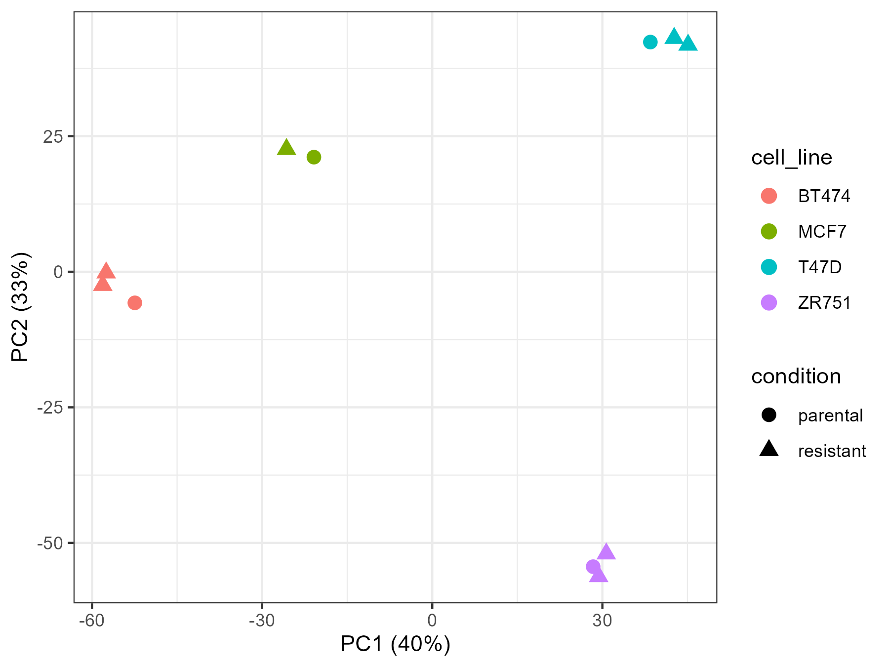
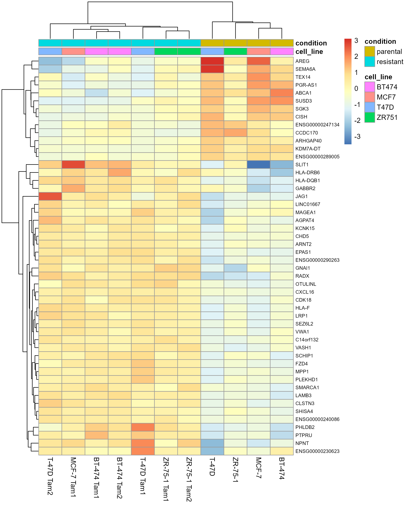

# Transcriptomic signatures of tamoxifen resistance in ER+ breast cancer

## Question

Which genes and pathways change consistently when ER-positive breast cancer cells become resistant to tamoxifen, across several independent cell lines?

## Data

- **GEO:** [GSE111151](https://www.ncbi.nlm.nih.gov/geo/query/acc.cgi?acc=GSE111151) (SRA: SRP133519, BioProject PRJNA436018)
- **Paper:** PubMed [30143015](https://pubmed.ncbi.nlm.nih.gov/30143015/)
- **Samples:** 11 bulk RNA-seq libraries (Illumina HiSeq 2000) from 4 ER+ cell lines, each with its tamoxifen-sensitive parental line and 1–2 tamoxifen-resistant derivatives

| Cell line | Parental | Resistant |
|---|---|---|
| MCF-7 | 1 | 1 |
| T-47D | 1 | 2 |
| ZR-75-1 | 1 | 2 |
| BT-474 | 1 | 2 |

## Workflow

**Upstream, on [Galaxy Australia](https://usegalaxy.org.au)** (a public bioinformatics platform):

1. Import FASTQ files from SRA (`fasterq-dump`)
2. Quality control with FastQC, adapter and quality trimming with fastp, summary with MultiQC
3. Transcript quantification with Salmon against GENCODE v46 human transcripts

**Downstream, in R** (`analysis/DE_analysis.Rmd`):

1. Gene-level summarisation with tximport
2. Exploratory analysis (VST, PCA, sample clustering)
3. Differential expression with DESeq2 using a paired design (`~ cell_line + condition`), with apeglm log fold change shrinkage
4. Comparison with edgeR (quasi-likelihood) and limma-voom
5. Gene set enrichment (fgsea, MSigDB Hallmark)

## Results



Cell line explains most of the variation, so differential expression uses a paired design (`~ cell_line + condition`).



**Key findings**

- **134 genes** change consistently with tamoxifen resistance across four ER+ cell lines (DESeq2, padj < 0.05, |log2FC| > 1).
- **Loss of ER signalling:** classic ER targets (PGR-AS1, AREG, SGK3, CISH) are down, and the Hallmark early estrogen response is depleted (NES -1.84).
- **Reduced proliferation:** MYC and E2F target programmes are down.
- **Mesenchymal, inflammatory and hypoxic shift:** EMT is the most enriched pathway (NES 2.47); TNFa/NF-kB, hypoxia and angiogenesis are also up, and HIF-2a (EPAS1) is the top gene.
- **Agrees with the original study:** cholesterol homeostasis is enriched, ABCA1 is down and LRP1 is up, matching the lipid reprogramming reported by Hultsch et al. (2018), while the paired design reveals a shared signature that the per-line analysis did not.

edgeR and limma-voom are more conservative here (8 and 14 genes), so the DESeq2 list is treated as candidates and pathway-level results as the main conclusion. Full results: the HTML report ([analysis/DE_analysis.html](analysis/DE_analysis.html)) and tables ([analysis/results/tables/](analysis/results/tables/)).

## Reproduce

1. Upstream: import `upstream_analysis_Galaxy/Galaxy-Workflow-GSE111151_bulk_RNASeq.ga` into [Galaxy Australia](https://usegalaxy.org.au) and run it on the SRA runs of SRP133519. Download one Salmon `quant.sf` per run into `data/salmon/`, named by SRA run accession (e.g. `data/salmon/SRRxxxxxxx.tabular`).
2. Download the run table from the [SRA Run Selector](https://www.ncbi.nlm.nih.gov/Traces/study/?acc=SRP133519) to `metadata/SraRunTable.csv` (already included in this repository).
3. Restore the R environment with [renv](https://rstudio.github.io/renv/) and render the report:

```bash
Rscript -e "install.packages('renv')"
Rscript -e "renv::restore()"
Rscript -e "rmarkdown::render('analysis/DE_analysis.Rmd')"
```

The first render downloads the GENCODE v46 transcript FASTA (about 70 MB) into `data/` to build the transcript-to-gene map.

## Limitations

- One library per cell line and condition, so the four cell lines serve as the biological replicates
- Cell-line models only; findings need validation in patient data

## Repository layout

```
├── analysis/                  R Markdown analysis and rendered HTML report
│   └── results/               figures and tables
├── metadata/                  sample annotation (GEO) and run table (SRA)
├── upstream_analysis_Galaxy/  Galaxy workflow and MultiQC report
├── renv.lock                  R package versions
└── scripts/                   package installation (alternative to renv)
```
